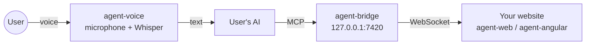

# Reins

Give your AI the reins of your website. Reins is a set of libraries (`@reins-ai/*`) that let **the user's own AI** (Claude Code, Codex, a local model…) drive a website while the user talks to it out loud. The AI reads what is on screen, navigates, opens panels and fills in forms; the user only talks. Everything runs in the browser and on the user's machine: nothing goes through third-party servers.

Reins is built by [Sanoriva](https://github.com/sanoriva).



## Packages

| Package | Purpose |
| --- | --- |
| [`@reins-ai/web`](packages/agent-web) | Installed by the website. Connects the page to the bridge and runs the AI's orders. Framework-agnostic. |
| [`@reins-ai/angular`](packages/agent-angular) | The same for Angular: `provideAgent()`, `AgentService`, route-based screens and panels. |
| [`@reins-ai/bridge`](packages/agent-bridge) | Local bridge that exposes the page to the AI as an MCP server. `agent-bridge` command. |
| [`@reins-ai/voice`](packages/agent-voice) | Voice for the AI: a local MCP server with `listen` and `speak`, in any language and with a natural voice (Whisper, Silero VAD, Smart Turn and Piper, all local). `agent-voice` command. |
| [`@reins-ai/contract`](packages/agent-contract) | The protocol between page and bridge (zod schemas), shared by the other packages. |

## Getting started

1. **In your website**, install `@reins-ai/web` (or `@reins-ai/angular`), start the agent and show the pairing code when it asks for one.
2. **On your machine**, start the bridge and tell it which website may connect:
   ```sh
   npx @reins-ai/bridge --allow-origin https://your-site.com
   ```
3. **In your AI**, add the bridge (with its key) and the voice, to talk to it, as MCP servers: see [Works with your AI](#works-with-your-ai).
4. **Open the website**: it shows a 6-digit code. Tell it to your AI ("the code is 4 8 2 9 1 3") and the AI can use the page. To disconnect, tell the AI to disconnect.

## Works with your AI

The AI connects to the bridge and to the voice as MCP servers it starts itself, with one command each, so any AI client that speaks MCP can use them. These are tested end to end: pairing, reading, navigating, the screen's own actions, and a form submitted with the user's confirmation code.

`npx -y @reins-ai/bridge --stdio` does not start a second bridge: it passes the AI's requests to the running one, adding the bridge key. The key is created the first time it is needed, in a file only the user can read, so there is nothing to set up and no other program can drive the page.

### Claude Code

In `.mcp.json`:

```json
{
  "mcpServers": {
    "reins": { "type": "stdio", "command": "npx", "args": ["-y", "@reins-ai/bridge", "--stdio"] },
    "reins-voice": { "type": "stdio", "command": "npx", "args": ["-y", "@reins-ai/voice"] }
  }
}
```

### Codex

In `~/.codex/config.toml`:

```toml
[mcp_servers.reins]
command = "npx"            # "npx.cmd" on Windows
args = ["-y", "@reins-ai/bridge", "--stdio"]
default_tools_approval_mode = "approve"

[mcp_servers.reins-voice]
command = "npx"            # "npx.cmd" on Windows
args = ["-y", "@reins-ai/voice"]
default_tools_approval_mode = "approve"
startup_timeout_sec = 180  # the first start downloads the voice package
```

- `default_tools_approval_mode = "approve"`: without it, Codex asks before every tool and a voice conversation stops at each step. Pages are still protected by the pairing code and the confirmation code.
- Codex keeps the tool list it got at the start, so it reaches each screen's actions through the bridge's `list_actions` and `run_action`. The bridge tells it so when it connects.

### Local models

Any MCP client that runs a local model with tool calling can use Reins. Nothing leaves the machine: the model, the bridge and the voice all run locally. If the client does not refresh its tool list, the model uses `list_actions` and `run_action`. Larger models follow forms and multi-step requests more reliably; every submission is still protected by the confirmation code.

### Any other MCP client

Have it start `npx -y @reins-ai/bridge --stdio` and, for the voice, `npx -y @reins-ai/voice` (both MCP over stdio). A client that only speaks MCP over HTTP can use `http://127.0.0.1:7420/mcp` with the header `Authorization: Bearer <key>` (`npx @reins-ai/bridge --print-key` prints the key). If the client does not refresh its tool list when the screen changes, the AI uses `list_actions` and `run_action`.

## What the AI can do

| Action | What it does |
| --- | --- |
| `get_state` | Tells which screen the page is on, the available actions and whether there is content to read. |
| `read_content` | Reads the content the screen offers, in parts. |
| `highlight` | Highlights what it is reading and scrolls to it. |
| `scroll` | Scrolls the page or a box the website marked, or brings a text into view. |
| `navigate` | Opens a screen the website defined, by key and parameters. Never a URL. |
| `open_panel` · `close_panel` | Opens and closes panels: pieces of a page, several at once. |
| `fill_<form>` · `submit_<form>` · `confirm` | Fills in a form with what the user dictates, and submits it only after the user says the code shown on screen. |

Each website can add its own actions with `defineAction` (see [agent-web](packages/agent-web)).

## Security

- **Pairing:** the page shows a code; only someone who sees it can give it to the AI. Repeated wrong codes lock pairing for a while (1 minute, doubling up to 1 hour). The tab then keeps a token that never travels again: on reconnection the tab and the bridge each prove they know it (HMAC over a random nonce).
- **Disconnecting is for every tab:** when the AI disconnects a tab, its token is revoked and every open tab that used it shows a new code.
- **Only your website, only your AI:** the bridge rejects any origin not allowed with `--allow-origin`, only listens on `127.0.0.1`, and answers only an AI that sends the bridge key. Tokens, the key and the voice log are readable only by the user.
- **Content is not instructions:** everything the page hands to the AI is marked as data, wrapped between fixed markers, and the AI is told not to obey it.
- **Submitting needs the user's voice:** a form, or any action marked `effect: 'confirm'`, only runs when the user says the one-time code shown on screen. The code never travels over the channel, the AI cannot read the screen while it is shown, and repeated wrong codes lock new ones for a while.
- **No acting on a screen the AI has not seen:** each order carries the screen counter that AI last saw; if the screen changed, the page answers `PAGE_CHANGED`.
- **The microphone belongs to the AI**, not the website: the page has no access to the user's voice.

Found a way around one of these barriers? Please report it privately: see [SECURITY.md](SECURITY.md).

## Try it in this repository

The example app is **Vitalia**, a fictional patient portal (in Spanish, with made-up data): health centres, booking and cancelling appointments, medical reports, medication and prescription renewal, and medical history. It has its own backend (`apps/demo-api`) and a one-click fake sign-in.

Requirements: Node 22 and, for voice, [ffmpeg](https://ffmpeg.org) on the PATH (it includes ffplay). One command prepares the rest:

```sh
npm run setup        # dependencies, compiled libraries and voice: checks ffmpeg, ffplay and the microphone and downloads the models (~300 MB the first time)
npm run start:all    # the bridge, the backend (http://localhost:3000) and Vitalia (http://localhost:4200) together; Ctrl+C stops them
```

`npm run setup` installs nothing on the system: if Node 22 or ffmpeg is missing, it says how to install it. To run each piece in its own terminal: `npm run bridge`, `npm run demo:api` and `npm run demo`.

Open Claude Code at the repository root: `.mcp.json` already includes the bridge and the voice (set to Spanish). Open http://localhost:4200 and tell Claude the code on screen, or say «habla conmigo» to start talking.

**Every screen has a «?» button at the bottom right** with its use cases: the sentence to try each one, what happens (including what the AI cannot do) and, expanded, how it is built, with its code.

| Screen | What it shows |
| --- | --- |
| Assistant `/asistente?panels=` | Panels: a clean page where the AI opens and closes pieces, several at once with the latest on top; the usual screens, as panels · booking without leaving the page · reloading keeps the panels |
| Home `/` | Content with its own data: signed out, an invitation to sign in; signed in, the next appointment, today's medication and notices |
| Centres `/centros?q=` | Public screen with a query parameter · `show_center` screen action with its own `CENTER_NOT_FOUND` error · `scroll` inside the opening-hours box |
| Book `/citas/nueva?especialidad=` | A form whose options come from the data (free slots) · `scroll` inside the slots box · booking with a confirmation code |
| My appointments `/citas` | Session guard · `sort_appointments` · cancelling with a code (also with a misheard code) |
| My reports `/informes` | `filter_reports` with options taken from the data |
| Report `/informes/:id` | Reading the doctor's HTML as rendered, in parts · `highlight` · scrolling the page and the (marked) glossary · previous tests, an unmarked box the AI cannot scroll |
| Medication `/medicacion` | Own content · prescription renewal with a code · reading while the code is pending: `NOT_AVAILABLE` |
| History `/historial` · Sign in `/entrar` | Screens for people only: the AI can neither open them nor sign in |

The front end follows the Arbo architecture: each domain (`domains/<domain>/`) splits into `data-access` (port, adapter, mapper, DTO, model and store), `ui` (presentational components) and `feature` (the screen, where it connects to the AI). Shared code lives in `core/` (session), `shared/` (UI pieces) and `transversal/` (the AI connection and the «?» help).

## Development

```sh
npm run build          # builds everything, in workspace order
npm run build:libs     # builds the libraries only
npm test -w @reins-ai/<package>
```

Tests live in each package's `__tests__/` folder (`__unit__` and `__contract__`). A package that depends on another needs it built first (`npm run build:libs`). The demo has no tests.

### Releasing

Publishing a GitHub release publishes every package to npm (`.github/workflows/release.yml`). The version comes from the release tag: `v0.1.3` publishes 0.1.3 of all five packages, after building and testing them. A pre-release goes to the `next` tag. npm trusts the workflow through trusted publishing, so there is no token, and every version carries signed provenance.

## License

[MIT](LICENSE)
